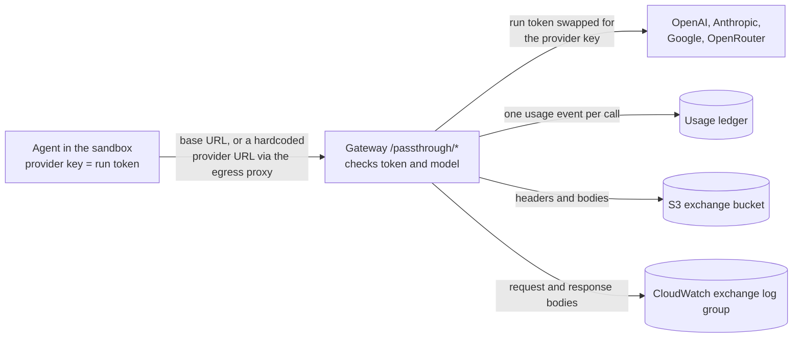

# Run tokens

Run tokens are opaque, task-scoped Gateway credentials. A managed `mgwk_` root has one required immutable project association and can call permitted models directly or mint/revoke `mgwt_` children; the sandbox receives only a child. Existing named static keys retain direct model access and can mint/revoke legacy `mgwt_` children in the current branch

Managed children bind to their root's stable managed-key ID and apply minted model and operation scope against the current Redis-published parent authority on every request; minted embedding scope remains the child's own. Control publishes active owner, project, optional root-key cap and optional shared project-limit authority from PostgreSQL on an asynchronous one-minute cycle; writes return without awaiting publication

Rotation replaces the root secret without changing its ID, project or cap, so children survive; root revocation or disabling a personal owner stops them after changed authority publishes, while child lease revocation remains separate. Legacy children bind to the static key's digest and minted scope

Managed `/query` and pass-through calls check both the project's shared cap and the root's own cap when configured. A project's cap counts all its keys; a root-key cap counts that root and every child, not each person or child separately, and can operate on an uncapped project

Each cap has its own daily, weekly or monthly period, with already-recorded attributable spend in that period counting even when the cap is newly set. First-key approval explicitly sets even an uncapped project policy; eligible additional keys issue without a second approval and may request an individual cap

A missing or unreadable managed spend snapshot returns HTTP 503 (previous-period or absent entries count as $0), and spend at/above either configured project or root-key limit returns HTTP 402; when both are unset, managed queries skip the spend check. Static keys have no email spending limit; snapshot delays can overshoot a managed cap

The query-runtime startup canary waits for its process's first complete published managed-authority generation, then uses a dedicated project-associated managed service root to mint a query-only child through control, call local `/query`, and revoke the lease. Its run ID includes the real Gateway release ID, and its task/attempt IDs are unique per startup

If its project or root has a cap, current spend for each capped scope is needed for the canary query; only the local canary call is excluded from ledger writes. This is initial process readiness, not a per-key activation or per-request freshness wait; liveness and control management remain available

For a first managed-auth rollout before a root exists, a per-execution `SkipStartupCanary=true` omits the canary and root-secret injection, but not the initial published-authority readiness gate. Once control is reachable, a platform-admin registers the machine service by name, sets `ModelGatewayHumanManagement.descope_machine_service_owner_id` to the returned UUID, and restarts control with that ID before Tracker makes a machine request. For a new project, Tracker in provision mode submits its first request; a platform-admin approves its initial project policy, and control can then create a genuine managed-service root with access to the canary model and `query` operation. Tracker's manual mode remains available; no rollout is activated by this branch. Supply the collected root to `ModelGatewayStartupCanary.managed_root` for a fresh normal release

Normal releases require the canary to pass, including any configured project or root-key cap admission; see [First managed-auth rollout](gateway.md#first-managed-auth-rollout). The current branch's static-key coexistence does not establish DEV/PROD deployment or approve mappings, initial policies or migration of existing managed keys; their secret values must be preserved when a mapping is explicitly chosen

## Provider pass-through

The pass-through is for agents that talk to a provider in its own format (Claude Code, Codex, the Gemini CLI) rather than through `/query`. They keep their SDK, point its base URL at the gateway, and put the run token where the provider key would go. The gateway checks the token and the model, swaps in its own key and forwards the request close to as-is, so the sandbox never holds a real provider key and the agent still gets the API it was built for.



| Provider | Base URL | Routes | Token header |
|---|---|---|---|
| OpenAI | `OPENAI_BASE_URL=https://<gw>/passthrough/openai/v1` | `POST /responses` | `Authorization: Bearer` |
| Anthropic | `ANTHROPIC_BASE_URL=https://<gw>/passthrough/anthropic` | `POST /v1/messages` | `x-api-key` |
| Gemini | `https://<gw>/passthrough/google` | `POST /v1beta/models/{model}:generateContent` and `:streamGenerateContent` | `x-goog-api-key` |
| OpenRouter | `OPENROUTER_BASE_URL=https://<gw>/passthrough/openrouter/api/v1` | `POST /chat/completions`, `GET /models` | `Authorization: Bearer` |

Any other path under these prefixes is a 404, except that a `GET` on the Responses route gets a 426 so Codex gives up on its WebSocket attempt and goes straight to HTTPS. OpenRouter's `GET /models` is its own model list, filtered to the models the token can call. Valkyrie's egress proxy also rewrites hardcoded calls to `api.openai.com/v1/`, `api.anthropic.com/`, `generativelanguage.googleapis.com/` and `openrouter.ai/api/v1/` onto these routes, so agents that ignore base URLs end up here too.

The token only counts in that header. Google's SDKs can also send the key as `?key=`, but query strings end up in uvicorn and load balancer access logs, so the gateway never reads one (a request with only `?key=` gets a 401) and never forwards it. Other auth headers aren't forwarded either; only the provider's own request headers (`accept`, `content-type`, `anthropic-version`, `anthropic-beta`, `openai-beta`) go upstream. After that a call gets the same checks as `/query`: the model has to be in the token's `allowed_models`, managed project and key caps apply when configured, and every call (failed ones included) lands in the usage ledger. OpenRouter needs one more rule, since it takes routing suffixes on any model id (`:online` makes it search the web) and has router entries that pick the model themselves: a suffixed id gets a 403, and so does a router entry even when it's allowlisted. A model let in by an `openrouter/x/*` pattern rather than its own registry entry is billed at the `usage.cost` OpenRouter reports.

Forwarding a body as-is has one obvious hole: the model can ask the provider to fetch things for it, which is exactly what the sandbox's network policy is there to stop. So pass-through bodies are held to the same `egress`, `allow_urls` and `allow_provider_tools` claims as `/query`. Provider-side tools are stripped rather than refused, because Claude Code and Codex send them by default and would otherwise fail on every call. That means hosted tools in `tools` and in OpenAI `additional_tools` input items, Anthropic `mcp_servers`, an OpenAI stored `prompt` (it brings whatever tools it was saved with), and OpenRouter's plugins, presets, fallbacks and non-`function` tools. A `tool_choice` naming a removed tool goes too, and the usage event lists everything removed in `details.request.passthrough.removed_tools`.

URL inputs are refused instead: one the token can't fetch gets a 400 in the provider's error format (Gemini Files API URIs are fine, since those files are already at Google). So does a body that isn't a JSON object or repeats a key, because the provider could read a different model or tool list than the one the gateway checked. Both kinds of refusal log `gateway.run_token.egress_blocked` with `route=passthrough`.

With `GATEWAY_PASSTHROUGH_EXCHANGE_BUCKET` set (deployed query runtimes have it), each call is also saved once its response ends: the raw request and response bodies and both sides' headers, gzipped to `s3://<bucket>/passthrough/<run>/<attempt>/<query>/{request,response,headers}`, plus `forwarded` when tools were removed. Each id is URL-escaped, so a `/` in one stays inside its own folder. The usage event's `details.request.passthrough.exchange` holds the keys and the sha256 of the raw bytes. Credential-looking request headers (`auth`, `key`, `token`, `secret`, `cookie`, ...), response cookies and the query string are never stored, and if S3 falls more than 256 MiB behind, new exchanges are dropped (their events have no `exchange`). The gateway's role can only put objects; reading them back takes `GatewayPassthroughExchangeReaderRole`.

With `GATEWAY_PASSTHROUGH_EXCHANGE_LOG_GROUP` set (deployed query runtimes have it), bodies are also streamed to CloudWatch Logs: the raw request body before the call goes upstream, so monitors need not wait for the response, and the response body once it ends. Each event is JSON with `part` (`request` or `response`), the run/attempt/question/query ids, provider, model, path, `stream`, `exchange_prefix` (the S3 folder above), `sha256` of the raw body and `body`; response events add the upstream `status_code`. Bodies over one CloudWatch event are split into `chunk`/`chunks` pieces to join in order. Headers and the query string are never sent. `run_id`, `attempt_id` and `query_id` are field indexes, so Logs Insights queries filtering on them skip other runs. The log group (`/model-gateway/passthrough-exchanges-<stage>`) keeps events for 7 days, so it is a short-lived feed; it is best-effort (writes that still fail after the SDK's standard retries, or more than 256 MiB behind, are dropped and logged), so S3 stays the record. The gateway can only create streams and put events; reading or live-tailing takes `GatewayPassthroughExchangeReaderRole`.

## Mint

- `POST /service-auth` on the control runtime, authenticated with an active managed root or an existing configured key (explicit request; the SDK does not exchange keys or mint automatically):
  ```json
  {
    "run_id": "run-123",
    "task_id": "task_0",
    "attempt_id": "attempt-1",
    "allowed_models": ["openai/gpt-4o"],
    "identity": {"benchmark_name": "valsmith", "agent_name": "opencode"},
    "ttl_seconds": 9000
  }
  ```
  - Required:
    - `run_id` and `task_id`; `attempt_id` is the normal mint input. An omitted `attempt_id` remains accepted for existing callers and stamps no attempt; no removal date is set
    - `allowed_models`: required registry keys, checked at mint; the minted list sets child model scope (managed roots currently add no model restriction). A `provider/x/*` entry (e.g. `openrouter/openai/*`) admits every id under `x/` on that provider's pass-through route only, where unregistered models are priced from the provider's reported cost
    - `ttl_seconds`: 1 to 604800 (7 days). There is no renew, so size it to outlast the task
  - Optional:
    - `allowed_embedding_models`: `/embeddings` `embedding_model` values; the minted list sets child embedding scope, including for managed children
    - `allowed_operations`: narrows provider routes (`query`, `tokens_count`, `files_upload`, `embeddings`, `moderation`, `audio_transcriptions`, `rate_limit`); all when omitted
    - `identity`
    - `egress`: the sandbox's network allowlist (URLs, hosts, `*.` wildcards, IPv4 CIDRs; blank, malformed or IPv6 entries are rejected at mint, as the sandbox rejects them); `"*"` (default) is unrestricted
    - `allow_urls`: default `false`; enables provider-fetched URL inputs, subject to `egress`
    - `allow_provider_tools`: default `false`; provider-side tools (`native_web_search`, `web_fetch`, `mcp`, …) are stripped unless set
- Response: `{"token": "mgwt_…", "lease_id": "<sha256 of token>", "expires_at": <unix seconds>}`. Keep the `lease_id`

## Use

- The sandbox sets `MODEL_GATEWAY_API_KEY` to the token.
- Run tokens may call provider routes in their minted `allowed_operations` and `/registry` filtered to their minted models. Managed children also reflect current published root model and operation permissions (currently unrestricted); configured static-root children have no published-parent check. Every other route returns 403
- Provider requests must name a model in `allowed_models`, and an embedding model in `allowed_embedding_models`.
- Config overrides retain the provider route's rules: `custom_endpoint` and `registry_key` are refused for every caller
- The gateway stamps `run_id`, `question_id` (= `task_id`), `attempt_id` when supplied at mint, and `identity` over what the sandbox sends
- Run tokens cannot set `token_retry_params`: they reconfigure provider budgets shared across runs.
- `/query` and `/tokens/count` filter what would make the provider fetch, including restored signed history:
  - URL inputs are stripped without `allow_urls`, or when outside a restricted `egress`. Exceptions are `data:` URLs and `FileWithId` values starting with `https://generativelanguage.googleapis.com/`, which are treated as provider-uploaded handles
    - Recognized URL inputs: `FileWithUrl`, URI file IDs such as `gs://…`, and provider content parts that fetch (`image_url`/`file_url`/`file_data`… fields, Anthropic `source.type=url`, Gemini `file_data.file_uri`, Bedrock `s3Location`)
    - Content parts are read in raw inputs and, for adapters that send tool results as content (OpenAI Responses/Chat, Mistral, …), in list tool results
    - Tool call arguments, tool result data and ordinary JSON fields named `url` are kept
  - Provider-side tools (`native_web_search`, `web_fetch`, `mcp`, …): stripped without `allow_provider_tools` or with a restricted `egress`. Client tools are kept.
  - A text notice is added. When URLs are blocked, it lists those URLs; tools-only removals use the generic notice.
- Run tokens cannot set `provider_config` on router entries with YAML settings (pool, tier, preference): it replaces the entry's whole config, which would drop them.

## Revoke

- `POST /service-auth/revoke` on the control runtime, authenticated with the key that minted the child. Takes effect immediately
- `{"lease_id": "…"}`: 200 `{"revoked": 1}`, 404 unknown or already revoked lease, 403 minted by another key
- `{"run_id": "…"}`: atomically revokes the live tokens already indexed for that key and run when the Redis script executes; 200 `{"revoked": <count>}`. A concurrent mint whose Redis transaction executes afterward can survive, even if the HTTP calls overlap

Existing configured key values and their digest-bound run tokens remain valid while the key stays in the allowlist. They are not imported into managed records; managed-key issuance and client migration are separate
